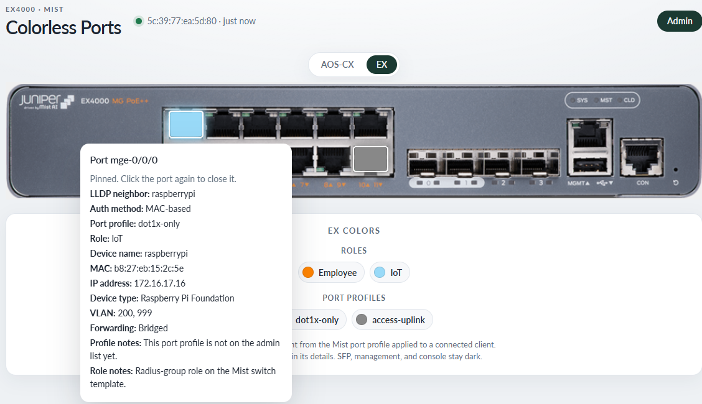
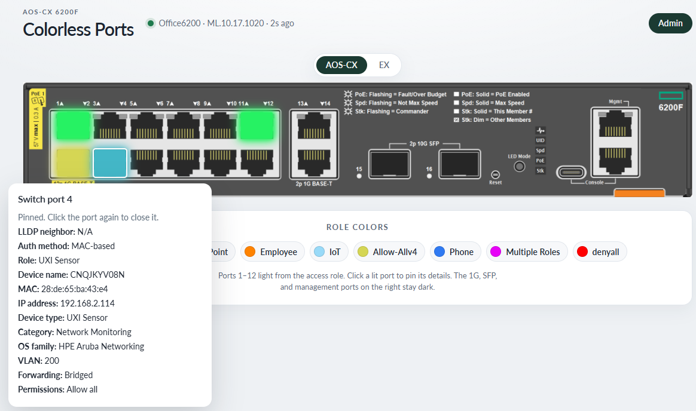

# Colorless Ports

A single-demo faceplate for colorless access ports. When a device connects, the matching jack lights. The legend is built from the colors in use. Click a lit jack to pin its details.

There is no application login. Switch, ClearPass, and Mist credentials are entered on the Admin page and stored in one SQLite file.

## The demo

EX4000. This shot is the Mist source: the pinned jack shows the port profile and the Mist role. Choose Junos under EX polling to read the switch directly. The popover then says Firewall filter.



AOS-CX, read from the switch. The faceplate follows the chassis part number: 6200F 12-port or 6300F 24-port (JL666A). ClearPass adds the device detail on this faceplate when it is configured.



## What's supported today

The EX4000 faceplate, plus two Aruba faceplates chosen from the switch. A different chassis does not match the photo or the jack map, and its stage stays blank.

**Aruba 6200F 12-port and 6300F 24-port (JL666A).** The app reads the switch REST API directly and uses the chassis part number. There is no model picker. Ports are odd on top and even on the bottom. The 6200F lights `1/1/1` through `1/1/12`; the 1G, SFP+, and management ports on the right stay dark. The 6300F (JL666A, and the TAA twin S0G96A) lights `1/1/1` through `1/1/24`; the SFP56, console, and management ports on the right stay dark. Both photos keep their own shape inside the same column, so a longer chassis does not skew or widen the page. The color is the role the switch applied. The popup shows that role. A name in Admin that matches it supplies the color, and a role that is not listed stays grey. The legend uses the label. ClearPass is optional: when it is configured it adds device name, type, and address to the Aruba popover. The demo runs, and the jacks still color, with ClearPass left blank. This faceplate does not call Mist. Other Aruba models, including a 6200F 24-port, stay blank.

**Juniper EX4000, 12 copper ports.** Ports `0`–`11` (`ge-0/0/0`–`ge-0/0/11`, or `mge-0/0/0`–`mge-0/0/11`) are the copper jacks. On an EX4000-12MP the first four are usually `mge` and the rest `ge`. SFP ports (`xe-0/1/*`), management, and console stay dark. ClearPass is not queried. A link with no client or session stays dark.

One source is live. Under Juniper/Mist, EX polling chooses Mist or Junos, and Save applies that choice. The other source stays filled in and idle. Junos reads the switch REST API. The switch must already have `system services rest https` (port 3443 by default). Mist uses a radius-group role when Mist applied one, and the port profile otherwise. There is no port profile on the Junos path.

Junos has no role object. Mist still calls it a Role. Mist pushes an ethernet-switching firewall filter of the same name only after that role is applied to a Switch Policy. In Mist, that firewall filter is the Switch Policy. A role that is not on a Switch Policy is never pushed, so the filter and the role never appear on the switch. The faceplate says Role for Mist and Firewall filter for Junos. The FAQ next to Admin spells this out.

Not covered: other Aruba or Juniper chassis, and Aruba Central as a data source.

`SUPPORT.md` is the field-by-field description of what each faceplate reads.

## Stand up the server

Docker and Docker Compose are the way to run it.

```bash
docker compose up --build
```

The service listens on port **8080**.

- Faceplate: `http://localhost:8080/`
- Admin: `http://localhost:8080/admin`
- Health: `http://localhost:8080/api/health`

Open Admin and fill in the switch. Add ClearPass only if you want the extra Aruba client fields. For the EX faceplate, fill in Junos (host, username, password) and the Mist API token, site ID, and switch MAC. Under EX polling, choose Mist or Junos and Save. That choice is what gets polled. Then set the port profiles and roles. Load from Junos reads ethernet-switching filter names already on the switch, which includes a Mist role only after it is applied to a Switch Policy. Load from the Mist switch template reads radius-group roles from the template. Save keeps the list. A blank password, client secret, or API token on Save keeps the value already stored. Admin never returns those secrets.

The poller runs only while a browser has the faceplate open.

Settings live in SQLite on the `colorless-data` volume (`/data/colorless.db` inside the container). `docker compose up --build` and `docker compose build --no-cache` keep that volume. `docker compose down` keeps it too. `docker compose down -v` deletes it.

The image does not mount the source tree. After a code change, run `docker compose up --build` again. A browser reload of the old container is still the old build.

### Without Docker

Python 3.12 and the packages in `requirements.txt`:

```bash
python3 -m venv .venv
.venv/bin/pip install -r requirements.txt
.venv/bin/uvicorn app.main:app --host 0.0.0.0 --port 8080
```

The database file is `data/colorless.db` in this directory, unless `COLORLESS_DB` points somewhere else.
